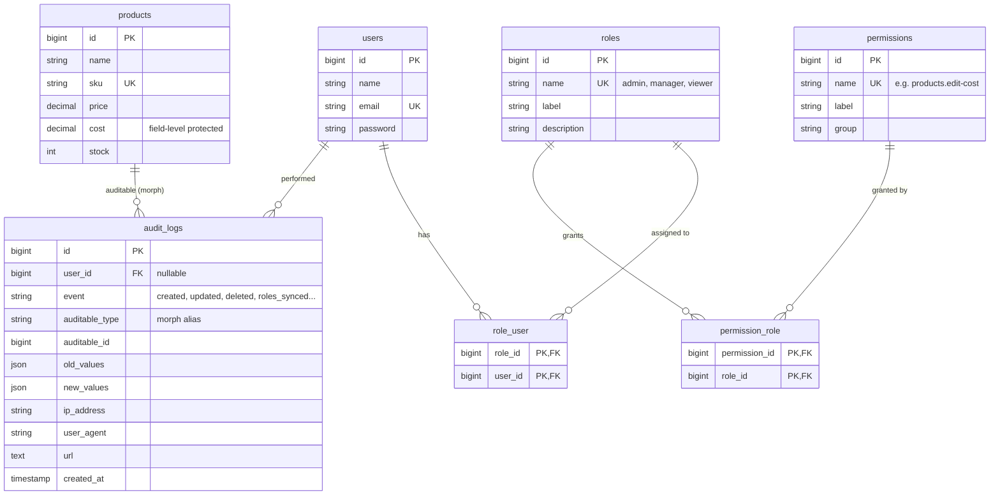

# Laravel RBAC + Audit Log Starter

[](https://github.com/Zain-Irfan/laravel-rbac-audit-starter/actions/workflows/tests.yml)


An open-source starter and demo project (not a client project) showing how to build **role-based access control**, **field-level permissions** and a **model audit trail** from scratch, without `spatie/laravel-permission` or an auditing package. Everything plugs into Laravel's own Gate, so `@can`, policies, `Gate::authorize()` and the `can:` middleware work exactly as they do in any other Laravel app.

It's meant to be read as much as run: the moving parts are small, commented and covered by tests. Use it as a reference or as the starting point for your own app. The demo data (products, users) is fake.

---

## Features

**Roles & permissions**
- `roles`, `permissions` and two pivot tables, with permissions defined in one config file (`config/rbac.php`)
- A `HasRoles` trait for the `User` model: `hasRole()`, `hasPermission()`, `assignRole()`, `removeRole()`, `syncRoles()`, plus a `User::role('manager')` query scope
- Permission names double as Gate abilities through one `Gate::before` hook, so `$user->can('products.update')`, `@can`, `can:` middleware and policies all just work
- A configurable **super role** (Admin) that passes every check and can't be edited or deleted from the UI
- A `role:` middleware and an `@role(...)` Blade directive for the rare cases where the role itself is the rule
- Permission lookups are memoised per request: one query no matter how many `@can` checks a page runs
- `php artisan rbac:sync [--prune]` keeps the `permissions` table in step with the config
- New sign-ups get a default role (Viewer)

**Field-level permissions**
- A `HasFieldPermissions` trait maps attributes to the permission needed to see or change them, for example `Product::cost → products.edit-cost`
- That one map drives the table columns, the form inputs, the validation rules (`prohibited`, so a crafted request is rejected, not quietly saved) and audit-log masking

**Audit log**
- An `Auditable` trait records `created`, `updated` and `deleted` events with old and new values as JSON, plus the user, IP, user agent, URL and timestamp
- Only fields that really changed are stored. Timestamps, the primary key and `$hidden` attributes such as `password` are never logged, and you can exclude more per model.
- Pivot changes such as role assignments and role permissions are recorded as custom `roles_synced` and `permissions_synced` events
- An Audit Log page with filters (user, model, event, date range) and a per-record history timeline that keeps working after the record is deleted
- Values a viewer isn't allowed to see (such as cost) are masked in the log too
- `AuditLogger::withoutAuditing(fn () => ...)` for imports and seeding
- Stable morph aliases (`product`, `user`, `role`) rather than class names in the database

**Admin UI** (Blade + Tailwind, built on Laravel Breeze)
- Users: list, search, create, edit, delete, assign roles (you can't lock yourself out of Admin)
- Roles & Permissions: one roles × permissions matrix, create and delete roles
- Dashboard showing the signed-in user's effective permissions

**Tests**: 70 PHPUnit tests (Breeze's auth tests included) cover permission checks, middleware, Blade directives, the cost-field restriction, audit entries, filters, masking and admin flows.

---

## Data model



`audit_logs` is polymorphic: users and roles are audited too, so the same table holds their history.

### Seeded roles

| Permission | Admin | Manager | Viewer |
|---|:-:|:-:|:-:|
| `products.view` | ✓ | ✓ | ✓ |
| `products.create` | ✓ | ✓ | |
| `products.update` | ✓ | ✓ | |
| `products.delete` | ✓ | | |
| `products.edit-cost` (see/edit cost) | ✓ | | |
| `users.manage` | ✓ | | |
| `roles.manage` | ✓ | | |
| `audit.view` | ✓ | ✓ | |

Admin is the super role, so it gets every permission without needing rows. Try ticking `products.edit-cost` for Manager in the matrix and watch the Cost column appear for `manager@example.com`.

---

## Screenshots

> Screenshots go in [`docs/screenshots/`](docs/screenshots). Suggested shots:
>
> | | |
> |---|---|
> | `dashboard.png`: effective permissions per user | `roles-matrix.png`: roles × permissions matrix |
> | `products-admin.png`: products with cost & margin (Admin) | `products-manager.png`: same page, cost hidden (Manager) |
> | `audit-log.png`: filters and diffs | `history.png`: per-record timeline |

---

## Getting started

Requirements: PHP 8.3+ (with `pdo_sqlite`), Composer, Node 20+. It uses SQLite by default, so there's no database server to set up.

```bash
git clone https://github.com/Zain-Irfan/laravel-rbac-audit-starter.git
cd laravel-rbac-audit-starter

composer install
cp .env.example .env
php artisan key:generate

touch database/database.sqlite     # Windows: type nul > database\database.sqlite
php artisan migrate --seed

npm install
npm run build

php artisan serve
```

Open http://127.0.0.1:8000 and log in with any demo account. The password is `password` for all of them.

| Email | Role | What to try |
|---|---|---|
| `admin@example.com` | Admin | Everything: users, the permission matrix, cost and margin columns |
| `manager@example.com` | Manager | Create and edit products and read the audit log. Cost is hidden everywhere, including in the log |
| `viewer@example.com` | Viewer | Read-only product list, no admin links |

The seeder also makes a few audited edits as Admin and Manager, so the Audit Log isn't empty on first run.

To use MySQL instead, set `DB_CONNECTION=mysql` and the `DB_*` values in `.env`, then run `php artisan migrate --seed`.

### Running the tests

```bash
php artisan test
```

Tests run against in-memory SQLite (see `phpunit.xml`).

---

## Usage

### Checking permissions

```php
$user->hasRole('admin');                 // or hasRole('admin', 'manager') for any of them
$user->hasPermission('products.update');
$user->can('products.update');           // same, through the Gate (respects the super role)

Gate::authorize('update', $product);     // policy methods in app/Policies
```

```php
// routes/web.php
Route::get('/audit-logs', ...)->middleware('can:audit.view');
Route::get('/reports', ...)->middleware('role:admin,manager');
```

```blade
@can('products.edit-cost') <td>{{ $product->cost }}</td> @endcan
@role('admin') <a href="...">Admin tools</a> @endrole
```

### Adding a permission

1. Add it to `config/rbac.php` under a group:
   ```php
   'Orders' => ['orders.refund' => 'Refund orders'],
   ```
2. Run `php artisan rbac:sync`.
3. Tick it for the right roles on **Roles & Permissions** and check it with `@can('orders.refund')` or `can:orders.refund`.

### Adding auditing to a model

```php
use App\Models\Concerns\Auditable;

class Order extends Model
{
    use Auditable;

    // Optional: extra attributes to keep out of the log.
    // The primary key, timestamps and $hidden attributes are always excluded.
    protected array $auditExclude = ['last_synced_at'];
}
```

Then register a short alias for it in `app/Providers/RbacServiceProvider.php`, which also makes it appear in the Audit Log's model filter:

```php
Relation::enforceMorphMap([
    // ...
    'order' => Order::class,
]);
```

That covers create, update and delete. For changes Eloquent doesn't fire events for (pivot syncs, bulk actions, imports), write an entry yourself:

```php
$order->audit('status_overridden', ['status' => 'pending'], ['status' => 'shipped']);

$order->audits;                          // full history, newest first

app(AuditLogger::class)->withoutAuditing(fn () => Order::insert($rows));
```

> Mass updates like `Order::where(...)->update([...])` skip Eloquent events, so they aren't audited. Iterate the models, or log the bulk change yourself.

### Protecting a field

```php
use App\Models\Concerns\HasFieldPermissions;

class Employee extends Model
{
    use HasFieldPermissions;

    public function fieldPermissions(): array
    {
        return ['salary' => 'employees.view-salary'];
    }
}
```

`$employee->hiddenFieldsFor($user)` and `canAccessField($user, 'salary')` give you what you need for views and validation (see `ProductRequest`). The audit log masks these fields automatically.

---

## Project map

```
app/
├── Models/Concerns/
│   ├── HasRoles.php              roles, permission checks, memoisation
│   ├── HasFieldPermissions.php   attribute → permission map
│   └── Auditable.php             hooks model events into the audit log
├── Observers/AuditObserver.php   builds old/new diffs
├── Services/AuditLogger.php      writes entries (user, IP, URL, UA), on/off switch
├── Providers/RbacServiceProvider.php   Gate::before, @role, morph map
├── Http/Middleware/EnsureUserHasRole.php
├── Http/Requests/ProductRequest.php    field-level validation
├── Policies/ProductPolicy.php
└── Console/Commands/SyncPermissions.php   php artisan rbac:sync
config/rbac.php                   permissions, seeded roles, super/default role
```

## Design notes

- **Why `Gate::before` and not one `Gate::define` per permission?** Defining abilities at boot needs a database query on every request, including requests that never check a permission, and it breaks before migrations run. The `before` hook resolves permissions lazily and returns `null` rather than `false` when the user lacks one, so policies still get the final say on record-level abilities like `update`.
- **Why reject a forbidden field instead of ignoring it?** Silently dropping input hides bugs and probing. A `prohibited` rule fails loudly and is easy to test.
- **Why morph aliases?** `audit_logs.auditable_type = 'product'` survives refactors. `App\Models\Product` doesn't.
- **Not included, on purpose:** teams or multi-tenancy, per-user permission overrides and caching permissions across requests. Each is a small step from here (e.g. cache `permissionNames()` with a version key bumped when the matrix is saved).

---

## License

[MIT](LICENSE) © Zain Irfan

## Author

**Zain Irfan**, Full Stack Developer (Laravel, Shopify apps, React)

- Portfolio: https://zain-irfan.vercel.app
- LinkedIn: https://www.linkedin.com/in/zain-irfan-3356001aa/

Built with AI-assisted development (Claude Code). Designed, reviewed and maintained by Zain Irfan.
